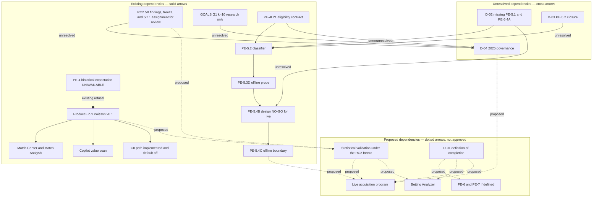

# Probability Engine — Architecture Continuity and Remaining Scope

## 1. Document control

**Document class:** provisional architecture-continuity record
**Status:** PROVISIONAL. This file is not an approved phase closure, not a production change, and not an authorization to implement.
**Repository:** `C:\Projects\apex-intelligence`
**Audited commit:** `ceb9d4d770a2733d49cb601ceda8df0cc30469f8` (`main`, matching `origin/main` at the preflight for this file)
**Date:** 2026-11-06
**Scope:** reconstruct the Probability Engine architecture and the remaining research scope from repository evidence at that commit.
**Required independent review:** a reviewer who did not write this file must check every material claim against the cited paths before any owner uses it as a decision input.
**Activation statement:** this document does not itself activate, close, or complete any phase. Creating it does not promote parameters, enable wiring, open sealed outcomes, or start a later program.

## Non-authorizations

This file does not authorize source edits, edits to existing documents, tests, configuration, Git commits, production activation, PE-6, PE-7, Betting Analyzer work, live API-Football acquisition, or reading sealed 2025 outcome files. Those limits are repeated in section 15.

## How to read labels

| Label | Meaning in this file |
| --- | --- |
| FACT | Observed in source, a committed document, or Git history at the audited commit. |
| HISTORICAL VERDICT | A conclusion recorded by an existing audit, a commit subject, or the owner brief that commissioned this file. Not re-executed here. |
| CONFLICT | Two repository statements, or a repository statement and a later commit, that this file does not reconcile. |
| PROPOSAL | A criterion or sequence offered for later review. Not an approved rule. |
| OWNER DECISION REQUIRED | A choice this file deliberately does not make. |

---

## 2. Executive architecture summary

Four systems share football-probability vocabulary. They are not one model, and they do not share one promotion path.

### A. Product Elo × Poisson v0.1 engine

FACT. The product probability implementation is `EloPoissonHybridEngine`, model version `elo-poisson-hybrid-0.1.0`, under `lib/intelligence/modules/probability/`. The contract is `docs/PROBABILITY_ENGINE.md`. Defaults live in `lib/intelligence/modules/probability/hybrid/config.ts` lines 7–24: home advantage 65 Elo points, Elo scale 400, base goals 1.45 / 1.15, Elo-to-goals scale 400, home-goals multiplier 1.0, draw base 0.28, draw decay 220, Poisson blend weight 0.7, score grid through 15 goals.

FACT. Product callers invoke this engine directly. Examples: `lib/match-analysis/match-analysis-service.ts` lines 44–59, `lib/match-center/from-data-platform.ts` lines 658–671, `lib/copilot/value-scan.ts` lines 81–87, and `lib/prematch-lifecycle/c0-recon-offline/pipeline.ts` lines 8 and 97. The Intelligence Core `PredictionPipeline` still throws and does not call the hybrid engine (`lib/intelligence/engine/pipeline.ts` lines 42–54). `docs/PROBABILITY_ENGINE.md` lines 180–182 remains correct about that pipeline and is stale if read as “the engine has no product surface.”

This engine is what Match Center, Match Analysis, Copilot value scan, and the C0 reconstruction path use for 1X2 and Over/Under 2.5. It is not a calibrated production probability in the statistical sense. Section 6 separates the shipping formula from two RC2 facts: 5C.1 later assigned CONTROL and candidates A–D and froze that set for review, and no candidate was promoted.

### B. GOALS research models

FACT. GOALS is offline research under `lib/debug/calibration/goals/`. The checkpoint `docs/PE4_GOALS_RESEARCH_CHECKPOINT_AUDIT.md` lines 22–40 records G1 attack/defense Poisson with shrinkage **k = 10** as the preferred research backbone, and records G3, distributional extension, market calibration, recent-goal form, and rest/fatigue as not promoted.

FACT. `lib/debug/calibration/goals/g1/protocol.ts` lines 25–34 freezes development season 2023, confirmatory season 2024, holdout season 2025 with policy `RESERVED_UNTOUCHED_NO_OUTCOME_EVAL`, and shrinkage candidates `[2, 5, 10]`. `selectedShrinkageK` is a function argument, not a constant in that protocol (lines 95–96 and 124). Later GOALS protocols pin a parent k of 10, for example `GOALS_G3_FROZEN_SHRINKAGE_K` and `GOALS_REST_PARENT_G1_K`. The checkpoint document is the place that states the selection. The protocol file does not hard-code the selected k by itself.

GOALS is research-only. It is not imported as the product probability engine. The checkpoint (lines 57–61) says lifecycle, scanner, probability-engine, and app routes do not import GOALS G0/G1/G3 into production.

### C. PE-4 offline feature and expectation research

FACT. PE-4 has two layers.

The earlier layer, PE-4A–H, lives mainly under `lib/prematch-decision/pe4-form-schedule/`. `resolvePe4HistoricalExpectation` always returns `status: "UNAVAILABLE"` (`lib/prematch-decision/pe4-form-schedule/expectation-contract.ts` lines 12–14 and 53–78). The reason recorded in code is that the product hybrid engine is not a valid consumer of common-baseline pairwise indices: it adds home advantage and asymmetric base goals, and PE-3 ticket Elo already embeds role bases 1580/1520. `lib/prematch-decision/index.ts` does not export this module (no `pe4-form-schedule` export; checkpoint lines 59–61).

The later layer, PE-4I.1–I.21, is offline acquisition, as-of-T features, and an eligibility contract. `docs/PE4I21_FEATURE_ELIGIBILITY_CONTRACT.md` lines 7–9 and 116–118 close PE-4 as an offline form-and-schedule research foundation, verdict **PASS WITH LIMITATIONS**. `PE4I21_PRODUCTION_WIRING` stays false. That close does not make historical expectation available and does not change G1 k.

PE-4 is research-only. The product still does not consume PE-4 expectation or the PE-4I feature matrix.

### D. PE-5 evidence classification and offline acquisition

FACT. PE-5 classifies squad evidence and, from PE-5.3 onward, probes and simulates acquisition. It does not fit a model.

- PE-5.2 classifies evidence and does not acquire, store, or fit it (`docs/PE5_2_OFFLINE_EVIDENCE_PROTOCOL.md` lines 1–3). `PE5_PRODUCTION_WIRING` is false (`lib/debug/calibration/pe5-availability/protocol.ts` line 12). `pe5Protocol()` also sets `collectorAuthorized`, `acquisitionAuthorized`, and `pe53Authorized` to false (lines 104–106).
- PE-5.3D is the current offline probe runner. It does not authorize a live provider call (`docs/PE5_3D_OFFLINE_PROBE_RUNNER.md` lines 1–3). `PE53B_LIVE_PROVIDER_AUTHORIZED` is `false` (`lib/debug/calibration/pe5-availability/probe-fixtures.ts` line 8).
- PE-5.4B is a design and threat model. Its own status line says no module in that document is implemented and that accepting the review does not authorize PE-5.4C or API-Football (`docs/PE5_4B_LIVE_ACQUISITION_SAFETY_DESIGN.md` lines 3 and 10).
- PE-5.4C code now exists under `lib/debug/calibration/pe5-acquisition-boundary/`. `PE5_4C_ORCHESTRATOR_LIMIT` sets `liveProviderAuthorization: false` and `productionReady: false` (`orchestrator.ts` lines 108–117).

PE-5 evidence is not a product model feature. Eligible rows “do not emit a model feature, a coefficient, or a join onto the PE-4 matrix” (`docs/PE5_2_OFFLINE_EVIDENCE_PROTOCOL.md` line 90).

### What the product uses

| System | Used by the shipping product path | Research-only |
| --- | --- | --- |
| Elo × Poisson v0.1 | Yes, by direct callers listed above. C0 reconstruction exists but default lifecycle mode stays `base_prior` while `PE3C_C0_RECON_ACTIVATION` is false (`lib/prematch-lifecycle/pe3-activation.ts` lines 14–24). | The formula is product code. Its statistical promotion is not done. |
| GOALS G0/G1/G3 and later GOALS audits | No | Yes |
| PE-4 expectation and PE-4I features | No | Yes |
| PE-5 classification, probe, and PE-5.4C offline acquisition boundary | No | Yes |

---

## 3. Authoritative source inventory

This provisional file does not supersede frozen protocols or approved audit decisions. Where a later commit makes an older sentence factually stale, both are kept. The older file is not edited.

### Governing documents requested for this inventory

| Document | Authority it actually has | What it does not govern |
| --- | --- | --- |
| `docs/PROBABILITY_ENGINE.md` | Product v0.1 formula contract for the hybrid engine. | PE-4, PE-5, GOALS, RC2 promotion, Betting Analyzer. |
| `docs/06-ai-engines.md` | Product map of probability, reasoning, learning, scoring, and vision boundaries (lines 21–39 and 53–59). | Phase register PE-3 through PE-5. It does not mention those phases. |
| `docs/PE3_FINAL_CLOSURE_AUDIT.md` | HISTORICAL VERDICT: PE-3 closed on one controlled live C0 ticket. C0 default remains off (lines 1–7 and 171–176). | A general claim that C0 is the production input, or that later research is closed. |
| `docs/PE4_GOALS_RESEARCH_CHECKPOINT_AUDIT.md` | HISTORICAL VERDICT at the PE-4 + GOALS checkpoint: research only, expectation unavailable, G1 k=10, rejected branches preserved (lines 1–49 and 51–61). | Production activation. The file itself says “research checkpoint candidate.” |
| `docs/PE4I21_FEATURE_ELIGIBILITY_CONTRACT.md` | Frozen offline eligibility contract and the PE-4 research close, verdict PASS WITH LIMITATIONS (lines 7–18 and 116–118). | Production wiring, model fitting, or the start of PE-5. Line 9 says “PE-5 is not started.” That sentence is true of the PE-4 close and stale as a description of HEAD. CONFLICT, preserved. |
| `docs/PE5_2_OFFLINE_EVIDENCE_PROTOCOL.md` | Offline evidence-class rules and the pin to the PE-4I.21 digest (lines 1–23). | A fresh independent closure audit. Line 7 says remediation was done and “a new independent closure audit has not been run.” The commit `b7c0ff6` subject says “close PE-5.2.” CONFLICT, preserved. Line 13 says PE-5.3, PE-6, and PE-7 are not started. PE-5.3 later has commits. PE-6 and PE-7 still have no implementation. |
| `docs/PE5_3D_OFFLINE_PROBE_RUNNER.md` | Current offline probe budget, transport isolation, and evidence-firewall limits. | Live transport. |
| `docs/PE5_3C_OFFLINE_PROBE_RUNNER.md` | Historical mechanism. Line 3 says it is superseded by PE-5.3D. | Current budget or transport behavior. |
| `docs/PE5_4B_LIVE_ACQUISITION_SAFETY_DESIGN.md` | Design and threat model at baseline `54cce2e`. Live pilot remains NO-GO (lines 784–802). | A statement of what HEAD implements. Lines 3 and 10 say no module in the document is implemented and that the review does not authorize PE-5.4C. HEAD now contains PE-5.4C offline code. CONFLICT: the design text is stale as an implementation inventory and still authoritative as a refusal of live acquisition. |
| `docs/calibration/RC2_5B_CALIBRATION_FINDINGS.md` | Diagnostic consolidation of sprints 5B.1–5B.16. It does not select production parameters (lines 1–7 and 196–209). | Permission to retune the product engine. |
| `docs/calibration/RC2_PROSPECTIVE_VALIDATION_FREEZE.md` | Freeze, dated 2026-09-19, of the next validation protocol before unseen outcomes are scored (lines 1–7 and 10–27). Its own slot table left A–D UNASSIGNED (lines 32–46). That UNASSIGNED table is the freeze’s text at the time it was written. It is not the current assignment. | A completed prospective score of a new candidate, and a claim that slots are still empty after 5C.1. |

### Other documents that still govern a slice

| Document | Slice |
| --- | --- |
| `docs/PE3_C0_LIVE_ACCEPTANCE_RUNBOOK.md` | Operator runbook cited by the PE-3 closure. Not re-executed here. |
| `docs/PE4I1` through `docs/PE4I20` | Stage records for the offline PE-4I program. Each file governs its own stage. I.21 is the eligibility close, not a silent rewrite of those stage records. |
| `docs/PE5_3C_OFFLINE_PROBE_RUNNER.md` | Superseded mechanism, kept as history. |
| `docs/calibration/RC2_5C_CANDIDATE_PREREGISTRATION.md` | RC2 5C.1 assignment of CONTROL plus A, B, C, and D. Commit `132f82c`. Status in that file: FROZEN FOR REVIEW — no unseen outcomes scored (lines 189–193). It does not score outcomes and does not promote production parameters. |
| Other `docs/calibration/RC2_5C_*` files | Prospective capture, scoring, and evaluation infrastructure in the RC2 commits 5C.2 `82162ad` through 5C.7 `f7c175f`. The auth commit `3f9ea64` lies in that ancestry and is not this infrastructure. These files do not score an unseen window and do not promote parameters. |
| `docs/LEARNING_ENGINE.md` | Separate post-match evaluation package. It says it does not modify the Probability Engine (lines 16–17). |
| `docs/MATCH_ANALYSIS.md`, `docs/COPILOT.md`, `docs/APEX_DATA_PLATFORM.md` | Product integration descriptions. They are not PE research protocols. |
| `lib/debug/calibration/pe5-acquisition-boundary/*` | The PE-5.4C offline implementation. There is no companion closure markdown in `docs/`. |

### Missing, superseded, and stale

| Item | Classification |
| --- | --- |
| PE-5.1 “strategic feasibility audit” | MISSING as a file. Cited only at `docs/PE5_2_OFFLINE_EVIDENCE_PROTOCOL.md` line 6. Status of the audit content is UNKNOWN. |
| PE-5.4A “read-only architecture audit” | MISSING as a file. Cited only at `docs/PE5_4B_LIVE_ACQUISITION_SAFETY_DESIGN.md` line 6. |
| First PE-5.4B text and the adversarial audits named as parents of R2 | MISSING as separate files. Only R2 is in `docs/`. |
| PE-5.3B markdown | MISSING. The phase exists as commit `71bc98e` and as the parent named by PE-5.3C. |
| PE-5.4C closure audit markdown | MISSING. Closure language in section 5 is therefore not a committed audit file. |
| PE-6 and PE-7 specifications | MISSING. The names appear as “not started” in the PE-5.2 document. |
| Betting Analyzer specification | MISSING. No repository document or module uses that name. |
| `docs/PE5_3C_OFFLINE_PROBE_RUNNER.md` | SUPERSEDED for mechanism by PE-5.3D. |
| `docs/PE5_4B_LIVE_ACQUISITION_SAFETY_DESIGN.md` lines 3 and 10 | STALE as an inventory of HEAD. Still the live-acquisition refusal. |
| `docs/PE5_4B_LIVE_ACQUISITION_SAFETY_DESIGN.md` lines 38–39, “`APEX_PE5_ACQUISITION_MODE` do not exist” | STALE as an inventory of HEAD. The offline authorizer now reads that key from a caller-supplied environment object. Still not a live-acquisition authorization. Pilot remains denied. |
| `docs/PE4I21_FEATURE_ELIGIBILITY_CONTRACT.md` line 9 and line 130, “PE-5 is not started” | STALE as a description of HEAD. Still the PE-4 close boundary. |
| `docs/PE5_2_OFFLINE_EVIDENCE_PROTOCOL.md` line 13, “PE-5.3 … not started” | STALE for PE-5.3. Still accurate for PE-6 and PE-7. |
| `docs/PROBABILITY_ENGINE.md` line 3, “sin frontend / APIs externas” | STALE relative to Match Center, Match Analysis, and Copilot. The formula sections match the code. |

---

## 4. Complete phase and subphase register

Status words are only COMPLETE, PARTIAL, NOT STARTED, BLOCKED, DEFERRED, or UNKNOWN. COMPLETE is always scoped. Where a file is absent, the status is UNKNOWN rather than reconstructed from the name.

| Item | Status | Evidence-supported scope |
| --- | --- | --- |
| Product Probability Engine v0.1 | COMPLETE | Mathematical v0.1 implementation and direct product callers exist. `PredictionPipeline.run` is still unimplemented. Statistical calibration and prospective promotion are not part of this COMPLETE. |
| RC2 diagnostic 5B.1–5B.16 | COMPLETE | Forensic consolidation only. No production parameter selected (`docs/calibration/RC2_5B_CALIBRATION_FINDINGS.md` lines 196–209). The only production-model change recorded there is 5B.1: team-id hash removal (lines 39–43 and 234–237). |
| RC2 prospective validation | PARTIAL | The 2026-09-19 freeze recorded slots A–D as UNASSIGNED and required a separate pre-registration before outcome access (`docs/calibration/RC2_PROSPECTIVE_VALIDATION_FREEZE.md` lines 32–46). Commit `132f82c` is that pre-registration. Later RC2 infrastructure commits are 5C.2 `82162ad` through 5C.7 `f7c175f`. The auth commit `3f9ea64` lies in that ancestry and is not this infrastructure. No unseen outcomes have been scored. Scoring unseen outcomes is NOT STARTED. No production parameters have been selected or promoted. |
| RC2 5C.1 candidate pre-registration | COMPLETE | Scoped to the written assignment only. `docs/calibration/RC2_5C_CANDIDATE_PREREGISTRATION.md` and `lib/debug/calibration/prospective/candidate-config.ts`, commit `132f82c`, assign CONTROL plus A, B, C, and D and mark that set FROZEN FOR REVIEW — no unseen outcomes scored. Definitions are in section 6. No unseen outcomes have been scored under that pre-registration. No production parameter has been selected or promoted. Owner acceptance is D-05 and is not decided here. |
| PE-3 program | COMPLETE | Closure audit: live acceptance PASS for fixture `1490209`, model `elo-poisson-hybrid-0.1.0`, C0 activation remains false (`docs/PE3_FINAL_CLOSURE_AUDIT.md` lines 1–7, 88–95, 171–173). Commit `24680fa`. Adding PE-3A and PE-3E below does not replace this verdict. |
| PE-3A prematch strength reconstruction | COMPLETE | Scoped to the offline reconstruction core in `lib/match-center/prematch-strength/`, introduced in `d39d8f0`. `types.ts` lines 1–5: pure offline reconstruction from a supplied fixture universe; it does not call providers or durable stores. `resolve-prematch-strength.ts` reconstructs prematch C0 Elo and provenance. `prematch-strength.test.ts` covers catalogue parity, leakage, determinism, explicit `base_prior` fallback, and inactive default wiring. No separate PE-3A closure document and no separate independent audit result were found. `PE3C_C0_RECON_ACTIVATION` remains false. |
| PE-3 named subphases 3B, 3C, 3F, 3G, 3H | COMPLETE | Named in `lib/prematch-lifecycle/pe3-activation.ts` lines 1–8 (3B, 3C, 3F), in `pe3b.integration.test.ts` and `pe3f.production-wiring.test.ts`, and in commits `038aeda` (3G verifier) and `d902fde` (3H season acquisition). Commit `d39d8f0` added the 3B, 3C, and 3F files in the same change as PE-3A and PE-3E. Default mode remains `base_prior`. `PE3C_C0_RECON_ACTIVATION` remains false. |
| PE-3E season-universe complete fetch | COMPLETE | Scoped to bounded page walking and offline remediation tests, also introduced in `d39d8f0`. `complete-fetch.ts` walks pages 1 through the reported total, hard-capped by `SEASON_UNIVERSE_MAX_PAGES` = 20, and fails closed when paging metadata is missing or inconsistent (lines 1–11, 16–17, and 76–149). A complete list does not prove historical immutability of scores or status. `pe3e.remediation.test.ts` lines 1–3: offline mocks only; the tests do not activate C0 and do not call live API-Football or Supabase. The production API-Football loader does not use this paged transport (`api-football-paged-transport.ts` lines 1–10). No separate PE-3E closure document and no separate independent audit result were found. `PE3C_C0_RECON_ACTIVATION` remains false. |
| PE-3D and any other lettered PE-3 subphase not listed above | UNKNOWN | No PE-3D module or governing document was identified. |
| GOALS G0–G1 and recorded later GOALS audits | COMPLETE | Offline research selection and rejections in the checkpoint. G1 k=10 is the research backbone, not a product model. |
| PE-4A–H | COMPLETE | Offline evidence, expectation dataset, and null residual-form result. Production historical expectation remains UNAVAILABLE. MODEL_C is a research reference, not wired (checkpoint lines 11–20 and 37–39). |
| PE-4I.1–I.21 | COMPLETE | Offline gap audit, acquisition through a 1094-unit queue, as-of-T features, strength catalogue, and eligibility contract. Independent verdict on I.21 is PASS WITH LIMITATIONS. Production wiring false. I.3 is a closed controlled live smoke document (`docs/PE4I3_CONTROLLED_LIVE_PROVIDER_SMOKE.md`), not a standing live authorization. Calendar-2025 and provider-season-2025 stay excluded (I.21 lines 15 and 129). |
| PE-5.1 | UNKNOWN | Parent is cited. The audit file is not in the repository. |
| PE-5.2 | PARTIAL | Protocol and classifier are committed (`b7c0ff6`). The document says a new independent closure audit has not been run. The commit subject says “close.” Both stand. |
| PE-5.3B | COMPLETE | Offline squad-coverage probe runner, commit `71bc98e`. Budget and transport mechanism were later replaced. No dedicated markdown. |
| PE-5.3C | COMPLETE | Offline safety hardening, commit `f436eb7`. The document is superseded by PE-5.3D. |
| PE-5.3D | COMPLETE | Current offline budget integrity and transport isolation, commit `54cce2e`. Not a live provider authorization. |
| PE-5.4A | UNKNOWN | Cited as a parent audit. The audit file is not in the repository. |
| PE-5.4B | COMPLETE | Design-only R2 at `d3d91bc`. It authorizes neither implementation nor live calls. HEAD later contains offline PE-5.4C code, which the design text does not describe. |
| PE-5.4C increments 1–8 | COMPLETE | Offline research implementation through increment 8 stage 2B at `ceb9d4d`. Not live, not production-ready. No closure markdown. The owner brief for this file records an offline research closure GO. That GO is a HISTORICAL VERDICT of the commissioning brief, not a sentence in `docs/`. |
| PE-6 | NOT STARTED | Named only as not started. No spec and no module. |
| PE-7 | NOT STARTED | Named only as not started. No spec and no module. |
| Live acquisition | BLOCKED | `PE53B_LIVE_PROVIDER_AUTHORIZED` is false. PE-5.4B pilot is NO-GO. PE-5.4C limits say live authorization is false. No later document reverses that. |
| Betting Analyzer | NOT STARTED | No specification, module, or phase document. What the name means is UNKNOWN. |

---

## 5. PE-5.4C formal closure record

### What the repository itself shows

FACT. Ten commits after the PE-5.4B design (`d3d91bc`) implement eight numbered increments. The first seven commits are increments 1–7. Increment 8 is the last three commits. Subjects, oldest to newest:

| Commit | Subject |
| --- | --- |
| `51354fa` | PE-5.4C offline authorization increment 1 |
| `efdfa56` | PE-5.4C offline in-memory ledger increment 2 |
| `9780451` | PE-5.4C offline canonical operation identity increment 3 |
| `96cfaf2` | PE-5.4C offline vendor-day rollover increment 4 |
| `5646654` | PE-5.4C offline response normalization increment 5 |
| `f93484c` | PE-5.4C offline immutable raw envelopes increment 6 |
| `b77c35d` | PE-5.4C offline transport simulation increment 7 |
| `a55ce88` | PE-5.4C increment 8 stage 1 security hardening |
| `bfbd211` | PE-5.4C increment 8 stage 2A evidence log |
| `ceb9d4d` | PE-5.4C increment 8 stage 2B offline orchestrator |

FACT. Final checkpoint in this series is `ceb9d4d770a2733d49cb601ceda8df0cc30469f8`.

FACT. Module headers and tests name the same increments. The ledger file header currently says “increment 4” (`memory-ledger.ts` lines 1–2) because vendor-day behavior landed in the file that increment 2 introduced. The test suite title still says “increment 2 memory ledger” (`pe5-4c-ledger.test.ts` line 270). That is a labeling overlap, not a missing increment. Stage 2A is `evidence-log.ts`. Stage 2B is `orchestrator.ts` lines 1–9.

FACT. `PE5_4C_ORCHESTRATOR_LIMIT` (`orchestrator.ts` lines 108–117) records in-process durability, no disk persistence, no cross-process consistency, no crash recovery, no live provider authorization, and `productionReady: false`.

### Historical closure verdict supplied for this record

HISTORICAL VERDICT, from the owner brief that authorized this document, not from a committed PE-5.4C audit file, and not re-executed while writing this file:

- Offline research closure: **GO** for the implemented offline PE-5.4C scope.
- Eight increments are in the tree, including increment 8 stages 1, 2A, and 2B.
- A completed audit reported **480** passing PE-5.4C tests.
- A completed audit reported **2040** passing tests in a full suite run.

This document-writing task did not run Vitest, `tsc`, or ESLint. Those counts are descriptions of completed audits. They are not new results.

Reconciliation, so the figures are not mistaken for executed totals or for source constants. A static, line-anchored count of `it(` sites in the eight `pe5-4c-*.test.ts` files is 283: authorize 30, ledger 52, operation-id 16, normalize 77, raw-store 20, transport 26, evidence-log 31, orchestrator 31. A further static, line-anchored count of `it.each(` sites is 30: authorize 2, normalize 23, orchestrator 5. These are source-site counts. They are not expanded executed test counts. An `it.each` site becomes multiple cases only when a runner executes that file. The repository at this commit does not contain a committed log of 480 or 2040. The historical totals of 480 PE-5.4C tests and 2040 full-repository tests stand as audit results. They were not recomputed here. Vitest was not run.

CONFLICT. `docs/PE5_4B_LIVE_ACQUISITION_SAFETY_DESIGN.md` still says the design review does not authorize PE-5.4C. The later commits exist anyway. This file does not treat the design sentence as deleted, and it does not treat the commit series as a live-acquisition approval. The GO above is offline research closure only.

### Four LOW findings

The severity word LOW is the historical audit classification in the commissioning brief. The behaviors below are FACT in the source. They do not, on that historical classification, invalidate offline closure. They remain relevant to any future live integration.

1. **Unresolved reserved and sending rows.** A lost `beginSend` acknowledgement commits `state = "sending"` and then returns `ambiguous` (`memory-ledger.ts` lines 833–856). An idempotent reserve returns the existing state, which may already be `reserved` or `sending` (lines 765–781). Nothing in the orchestrator limit provides crash recovery or another process that can finish those rows (`orchestrator.ts` lines 108–114). `pe5-4c-operation-id.test.ts` lines 5–6 say cross-process and durable deduplication stay unresolved.

2. **Public simulator fault injection.** `applyPe5OrchestratorFault` is an exported function (`orchestrator.ts` lines 355–369). `corruptStoredBytesForTests` is an exported simulator control (`raw-store.ts` lines 283–290). `replaceVendorDayBoundaryForTests` is documented as a simulator control on a module with no live transport (`memory-ledger.ts` lines 534–541). These controls are not confined to a test-only module.

3. **Unexpected exceptions can lose operation identifiers.** `executePe5OfflineOrchestrator` catches any throw from `run` and returns `unknown(null, null)` (`orchestrator.ts` lines 348–352). The failure result type allows `operationId: string | null` (lines 182–188). An exception before or outside a returned proof therefore has a null operation id.

4. **Approval expiry is not rechecked at `beginSend`.** `evaluateReserve` denies when `now >= state.approval.expiry` (`memory-ledger.ts` lines 747–749). `evaluateBeginSend` checks kill freshness, reservation token, lease deadline, fetch-timeout margin, and vendor-day ceiling (lines 872–957) and does not compare `now` with `state.approval.expiry`. The orchestrator calls `evaluateAuthorization`, which does check expiry (`authorize.ts` lines 132–134), and then calls `beginSend` (`orchestrator.ts` lines 434–477) without a second expiry check.

---

## 6. Quantitative-modeling status

Mathematical implementation and statistical validation are separate. The product probabilities are **not** labeled calibrated. RC2 5B did not select a production replacement. RC2 5C.1 later assigned review candidates and did not promote them. No unseen prospective promotion is recorded.

### Current production hybrid

FACT. Shipping math is the independent-Poisson hybrid in section 2.A. RC2 names the same constants as the frozen CONTROL: S = 400, catalogue role bases 1580/1520, HA = 65, `eloDrawBase` = 0.28, blend = 0.7, independent Poisson (`docs/calibration/RC2_PROSPECTIVE_VALIDATION_FREEZE.md` lines 40–41; findings lines 15 and 239–246). 5C.1 restates that same CONTROL as `CONTROL_PRODUCTION` (`docs/calibration/RC2_5C_CANDIDATE_PREREGISTRATION.md` lines 29–50; `candidate-config.ts` lines 18–39 and 61–68).

Catalogue bases 1580/1520 are caller inputs, not fields inside `DEFAULT_HYBRID_CONFIG`. Match Center applies them in `lib/match-center/from-data-platform.ts` lines 632–643. Copilot value scan uses the same role-base pattern (`lib/copilot/value-scan.ts` lines 71–87).

### Implemented Poisson mathematics

FACT. `poissonPmf` is `e^{-λ} * λ^k / k!` (`lib/intelligence/modules/probability/math/poisson.ts` lines 23–37). `scorelineProbability` multiplies independent home and away masses (lines 40–52). There is no Dixon-Coles τ and no bivariate Poisson term in this function. The engine still carries `TODO(dixon-coles)` (`elo-poisson-engine.ts` lines 30–31).

### Elo-derived expected goals

FACT. `eloToExpectedGoals` (`elo.ts` lines 41–59):

- `λ_home = μ_home * 10^((R_home - R_away) / S) * γ`
- `λ_away = μ_away * 10^((R_away - R_home) / S)`
- each λ is clamped to `[0.05, 6]`

Defaults: μ_home 1.45, μ_away 1.15, S 400, γ 1.0. Home advantage in the Elo 1X2 bridge is a separate +65 on the home rating (`eloWinExpectancy`, lines 14–24). It is not the same knob as γ.

### Score-grid truncation and normalization

FACT. `marginalizePoissonScoreGrid` sums `i, j` from 0 through `maxGoals` (default 15), divides 1X2 and Over/Under masses by `coveredMass`, and throws if covered mass is zero (`score-matrix.ts` lines 36–84). `normalizeOutcomeProbability` rescales a 1X2 triple to sum to 1, with a uniform fallback if the sum is zero (`normalize.ts` lines 18–36).

### 1X2 blend

FACT. Elo 1X2 inserts draw mass `D_base * exp(-|Δ| / D_decay)` with `Δ = R_home + HFA - R_away`, then scales the two-way win probabilities into the remaining mass (`elo.ts` lines 79–108). The hybrid is `w * P_poisson + (1 - w) * P_elo`, then renormalized (`elo-poisson-engine.ts` lines 124–141). Default `w` is 0.7.

### Over/Under 2.5

FACT. Over is the truncated-grid mass with `i + j >= 3`. Under is the rest. The market is taken from the Poisson marginal only. It is not blended with Elo 1X2 (`score-matrix.ts` lines 29–31 and 59–61; `elo-poisson-engine.ts` lines 96–98). Both-teams-to-score uses the same truncated grid (`score-matrix.ts` lines 87–115) and is a product helper, not a second engine.

### Entropy-based confidence

FACT. `confidenceFromHybrid` is `1 - H_norm`, where `H_norm` is Shannon entropy of the blended 1X2 divided by `log2(3)`, clamped to `[0, 1]`. Bands are high at `>= 0.75`, medium at `>= 0.45`, otherwise low (`confidence-from-hybrid.ts` lines 16–23; `normalize.ts` lines 81–98). The file says Decision Engine confidence on a 0–100 scale is a different metric (lines 1–4). This confidence is a transform of the predicted distribution. It is not a measured calibration score.

### RC2 findings and non-promotion

HISTORICAL VERDICT, frozen 2026-09-19. Findings lines 17–28 and 177–209:

- Team-id hash fallback was invalid and was removed in 5B.1.
- Catalogue geometry can create large Elo gaps. Role-base asymmetry, no shrinkage, and cumulative goal difference contribute.
- Elo-to-xG with S = 400 amplifies those gaps. The λ clamp limits extremes. It does not cause them.
- Draw underprediction is not one draw knob.
- Independent Poisson underallocates HIGH_EQUAL scores, especially 2-2. That residual replicated across locked windows.
- A stable positive residual goal correlation was not found. Bivariate Poisson was not established.
- No production S, shrinkage k, role-base pair, goal-difference formula, Dixon-Coles ρ, draw base, blend, home advantage, λ3, or HIGH_EQUAL multiplier was selected.
- `PRODUCTION_CORRECTION_READY` remained NO at 5B.16 because no unseen window existed (findings lines 225–231).

Premier League 2023, 2024, and 2025 are used investigation seasons in that document (lines 27 and 19–24). Section 7 treats the conflict with later sealed-data rules. Those seasons must not be called unseen again **inside the RC2 5B record**. That sentence is not a global claim about every 2025 row in the repository.

### RC2 5C.1 assigned candidates, not a promotion

FACT. The prospective freeze left slots A–D UNASSIGNED and required a separate pre-registration before outcome access (`docs/calibration/RC2_PROSPECTIVE_VALIDATION_FREEZE.md` lines 32–46). That UNASSIGNED table remains the freeze’s own historical text.

FACT. The later pre-registration assigns the slots. `docs/calibration/RC2_5C_CANDIDATE_PREREGISTRATION.md`, commit `132f82c`, base commit `967b541f3947a4f9cfe0d1fe5eea57f3de880f62`, status **FROZEN FOR REVIEW — no unseen outcomes scored** (lines 1–7 and 189–193). The code manifest is `lib/debug/calibration/prospective/candidate-config.ts`. The pre-registration records manifest fingerprint `7adf4ab6324074c8d9ada7f6f8eb43d02847ab317949c952b559162faaaf402c` (lines 102–110). Exactly five arms. No sixth arm.

| Arm | ID | Exact assignment verified from the pre-registration and `candidate-config.ts` |
| --- | --- | --- |
| CONTROL | `CONTROL_PRODUCTION` | Production catalogue and transform: role bases 1580/1520, no shrinkage, S = 400, HA = 65, `eloDrawBase` = 0.28, blend = 0.7, independent Poisson. Not a new candidate. |
| A | `CANDIDATE_A_INPUT` | Elo role bases 1550/1550 and shrinkage k = 8, plus the C7 GD-rate term `clamp((GF−GA)/max(n,1), −3, 3) × 25`. Downstream production is unchanged, including S = 400. No HIGH_EQUAL operator. |
| B | `CANDIDATE_B_TRANSFORM` | Elo scale S = 600 on the production catalogue input. Everything else stays production. |
| C | `CANDIDATE_C_COMBINED` | Combination of A and B: exact A input plus exact B transform (S = 600). No HIGH_EQUAL operator. |
| D | `CANDIDATE_D_COMBINED_HIGH_EQUAL` | C plus the 5B.16 T1 transfer: HIGH_EQUAL mass for k-k, k ≥ 2, increased by 10% of its original HIGH_EQUAL mass and taken from non-draw cells only. |

No unseen outcomes have been scored under that pre-registration. No production parameters have been selected or promoted. Whether the owner will ACCEPT, AMEND, or RETIRE this pre-registration is D-05. This file does not make that decision and does not authorize scoring.

### Research-only G1 k = 10

HISTORICAL VERDICT. The checkpoint selects k = 10. The G1 protocol’s holdout policy is `RESERVED_UNTOUCHED_NO_OUTCOME_EVAL` (`goals/g1/protocol.ts` line 107). Child research protocols pin parent k = 10. None of that is a product λ formula. Product λ remains the Elo exponential in `elo.ts`.

### Unavailable PE-4 historical expectation

FACT. `resolvePe4HistoricalExpectation` ignores its input and returns null probabilities with reason `expectation_model_not_defined` (`expectation-contract.ts` lines 57–78). MODEL_C from PE-4G.4 is a research family name in the checkpoint (lines 17–18 and 39). It is not this function and it is not the product engine.

### PE-5 evidence is not a model feature

FACT. The PE-5.2 protocol forbids fitting, weights, odds, and EV (lines 20 and 90). The probe stores coverage measurements. It does not join them to the product hybrid. PE-5.4C can classify an offline response through `classifyPe5Evidence` (`orchestrator.ts` imports at lines 92–97). Classification is not promotion into `EloPoissonHybridEngine`.

---

## 7. Historical data and 2025 governance conflict

This conflict is unresolved. It needs an explicit future governance decision. This file does not declare 2025 globally unseen, and it does not declare sealed 2025 data available. No sealed outcome file was opened, read, unsealed, or evaluated for this document.

### RC2’s documented use of Premier League 2025

HISTORICAL VERDICT. `docs/calibration/RC2_PROSPECTIVE_VALIDATION_FREEZE.md` lines 18–27:

- PL 2023 was holdout in 5B.6–5B.16.
- PL 2024 was the development / pilot population.
- PL 2025 was holdout in 5B.6–5B.16.
- Those seasons “MUST NOT be called unseen again.”
- The freeze sprint itself required zero API and did not collect a new season.

`docs/calibration/RC2_5B_CALIBRATION_FINDINGS.md` line 27 repeats that 2023, 2024, and 2025 are used investigation seasons. Section 5B.14 discusses a 2025 extra draw rate as a LOW_EQUAL phenomenon (findings lines 130–138). That is a statement about an investigation that already used 2025 outcomes. It is not permission to open a sealed file now.

### Later GOALS, PE-4, and PE-5 sealed-data policies

FACT. The PE-4 + GOALS checkpoint says Premier League 2025 remains sealed for those research paths, with structural references only, and artifacts under `data/calibration/` gitignored (checkpoint lines 51–55). `.gitignore` line 38 ignores `/data/calibration/`.

FACT. GOALS G1 sets `GOALS_G1_HOLDOUT_SEASON = "2025"` and `holdoutPolicy: "RESERVED_UNTOUCHED_NO_OUTCOME_EVAL"` (`goals/g1/protocol.ts` lines 27 and 107).

FACT. PE-4I.2 sets `PE4I2_HOLDOUT_SEASON = "2025"` and policy `REJECT_2025_OUTCOME_AND_METADATA_IN_THIS_PROTOCOL` (`lib/debug/calibration/pe4-acquisition/protocol.ts` lines 21–27). Allowed acquisition seasons in that protocol are 2023 and 2024 (line 21).

### Calendar-2025 kickoff restrictions

FACT. `classifyHoldoutForResearch` returns `calendar_2025_sealed_outcome` when the UTC kickoff year is 2025 (`lib/debug/calibration/pe4-as-of-t-features/holdout-firewall.ts` lines 44–58). Research pools DEV_FITTING, FEATURE_SELECTION, CALIBRATION, and COMPARISON exclude those kickoffs (lines 36–42 and 65–86). `LEDGER_STORAGE` may retain raw rows (lines 31–34 and 90–100). PE-4I.21 says calendar-2025 ledger rows stay sealed and DEV rows contain none of those outcomes (I.21 lines 129).

FACT. A different predicate does not promote calendar year alone. `isResearchHoldoutOutcomeEvidence` always returns `false` (`lib/debug/calibration/pe4-acquisition/holdout.ts` lines 46–58). Its comment says a provider-season-2024 fixture with a calendar-2025 kickoff is not automatically research-holdout-2025 evidence, and that holdout outcome use requires an authorized holdout protocol. PE-4I.15’s firewall and PE-4I.4’s “always false” helper are both in the tree. They answer different questions. This file does not collapse them into one rule.

### Provider-season-2025 restrictions

FACT. The same classifier returns `provider_season_2025_forbidden` when `providerSeasonId === PE4I2_HOLDOUT_SEASON` (`holdout-firewall.ts` lines 52–54). `assertNoProviderSeason2025Request` throws for that season (`holdout.ts` lines 61–66). PE-5.2 fails closed on that classification and says the protocol does not read sealed 2025 outcomes (`docs/PE5_2_OFFLINE_EVIDENCE_PROTOCOL.md` lines 21 and 62–64). PE-5.3D stops a plan on a 2025 season or calendar kickoff (`docs/PE5_3D_OFFLINE_PROBE_RUNNER.md` line 70). PE-5.4B says holdout checks deny before reserve (design lines 65 and 490). The orchestrator calls `classifyHoldoutForResearch` before reserve (`orchestrator.ts` lines 92 and 446–447).

### The prospective validation freeze

HISTORICAL VERDICT for the freeze text, and FACT for what followed it. The freeze is the rule for any **later** candidate: pre-register formulas and code hashes before loading or scoring unseen outcomes (`docs/calibration/RC2_PROSPECTIVE_VALIDATION_FREEZE.md` lines 46 and 50–66). Unseen, in that document, means outcomes not used in 5B.1–5B.16. A historical season outside 2023–2025 can qualify only under the three conditions in lines 61–65. The freeze itself left slots A–D empty. Commit `132f82c` is the separate pre-registration that freeze required: CONTROL plus A, B, C, and D are assigned and frozen for review. No unseen outcomes have been scored under that pre-registration, and no production parameters have been selected or promoted. Primary metrics remain log loss, Brier, and ECE, not a combined score (freeze lines 71–79; 5C.1 lines 133–139). No production promotion at N = 100 (freeze lines 105–107). Accepting, amending, or retiring the 5C.1 text is D-05, not a decision of this section.

### Unknown dataset relationships

UNKNOWN, and left unknown on purpose:

- Whether the Premier League 2025 rows used in RC2 5B are the same files, a subset, or a disjoint extract from the calendar-2025 rows the PE-4 ledger is allowed to store.
- Whether any gitignored artifact under `data/calibration/` still contains those outcomes. This task did not list or open that directory. A clean Git status does not prove gitignored research files are unchanged, because Git does not track them.
- Whether “Premier League 2025” in RC2, “provider season 2025,” and “calendar-2025 kickoff” denote the same match set. PE-4I.4 exists specifically because provider season, calendar year, and research axis are different (`holdout.ts` lines 1–17).

OWNER DECISION REQUIRED. Someone must decide, without this file making the decision, which 2025 populations are already used, which remain sealed, and which future studies may cite RC2’s published aggregates without reopening outcome files.

---

## 8. Cross-module integration map

“Actual” means a call or import exists in product or lifecycle code. “Proposed” means a document or design describes a future join that the current flags forbid. This section does not propose turning disabled flags on.

| Module | Actual data flow | Proposed or frozen and not active |
| --- | --- | --- |
| Product Probability Engine | `EloPoissonHybridEngine.predict` from Match Analysis, Match Center data-platform mapping, Copilot value scan, and the offline C0 pipeline. | `PredictionPipeline` is still a stub (`pipeline.ts` lines 45–54). `docs/PROBABILITY_ENGINE.md` lines 166–174 still list calibration, Dixon-Coles, rating history, and pipeline wiring as TODOs. |
| Match Center | `from-data-platform.ts` resolves Elo, runs Match Analysis, then runs the hybrid engine again and builds the preview (lines 632–671). Mock data also calls the engine (`lib/match-center/mock-data.ts`). | PE-4 features and PE-5 squad classes are not inputs to this predict call. |
| Match Analysis | `analyzeBundle` predicts with the hybrid engine, then applies rules (`match-analysis-service.ts` lines 41–77). `docs/MATCH_ANALYSIS.md` lines 12–28 describe that flow. Rules do not refit Poisson. | OpenAI reasoning stubs still throw (`lib/intelligence/reasoning/not-implemented.ts`). |
| Copilot | `lib/copilot/load.ts` loads Match Center data, which already runs the hybrid path, and also exposes `loadCopilotValueScanMarkets`. Value scan calls `createEloPoissonHybridEngine` itself (`value-scan.ts` lines 9 and 81–87) and is documented as not hydrating a full Match Center (`load.ts` lines 29–32). | A single shared prediction object for both surfaces is not what the code does. |
| Vision | Live coordinator, live view, and the live Match Center route are tested to contain no `createEloPoissonHybridEngine` import (`lib/apex-vision/live/match-center-live.test.ts` lines 650–666). Markets origin in that test is `PREMATCH` (line 640). | PE-5.4B lists Vision live transport as `getLiveFixtures`, `getFixturesByIds`, and `getLiveEvents`, outside the PE-5 ledger (design lines 28 and 216). |
| C0 lifecycle | Code path exists. `PE3C_C0_RECON_ACTIVATION` is false, so the default resolver returns `base_prior` (`pe3-activation.ts` lines 14–24). One historical live ticket used `c0_recon` and passed verification (PE-3 closure lines 39–40 and 94–95). The offline C0 pipeline file says it is not imported by `runPrematchLifecycle` (`c0-recon-offline/pipeline.ts` lines 1–5). Scheduled production remains the BASE path (PE-3 closure lines 5–6). | Enabling C0 is a separate activation. This document does not enable it. |
| GOALS | Offline modules under `lib/debug/calibration/goals/`. | Not a product λ. Checkpoint forbids treating the checkpoint as production activation. |
| PE-4 | Research modules. Expectation function returns UNAVAILABLE. `PE4I21_PRODUCTION_WIRING` is false. | Joining the eligibility matrix to the product engine is not implemented. |
| PE-5 | Classifier, offline probe, and offline acquisition boundary under `lib/debug/calibration/`. Production wiring and live flags are false. | PE-5.4B’s live pilot is NO-GO until a later authorization and a credential rule are satisfied (design lines 798–802). |
| Learning engine | `docs/LEARNING_ENGINE.md` describes `lib/learning-engine/` as post-match evaluation that does not modify the Probability Engine. `docs/06-ai-engines.md` lines 53–59 separate that package from recommendation learning, which does not train models. Intelligence Core `LearningService` methods still throw (`lib/intelligence/modules/learning/index.ts`). | Automatic refit of μ, w, or Elo is a TODO in the product engine, not an active learning loop. |

### Duplicate production prediction in Match Center

FACT. On the data-platform Match Center path, prediction is computed twice for the same fixture:

1. `createMatchAnalysisService().analyzeBundle(...)` calls `this.engine.predict` (`match-analysis-service.ts` lines 53–59).
2. The same function then calls `createEloPoissonHybridEngine().predict(eloInput)` for `buildPreviewFromHybrid` (`from-data-platform.ts` lines 670–672).

Both calls receive the home and away Elo values resolved just above (lines 632–661). They are two engine instances and two `predict` calls. `docs/APEX_DATA_PLATFORM.md` lines 142–148 already notes that the Match Center view-model path “also runs PE + DE + Match Rating.” This duplicate is confirmed in the current source. It is not, by itself, evidence that the two numeric results diverge. It is evidence that the product pays for two hybrid evaluations and keeps two result objects.

Copilot can add a further hybrid evaluation when value scan runs, separate from a full Match Center load. That is a second product entry point, not the Match Center duplicate above.

---

## 9. Security and data-governance boundaries

| Boundary | Evidence | Current effect |
| --- | --- | --- |
| Offline-only authorization | `evaluateAuthorization` returns `allow-offline` only after flag, clock, kill, mode, expiry, and ledger-instance checks. `pilot` returns `pilot_not_authorized` (`authorize.ts` lines 101–156). | A passing offline decision is not a live send. |
| Default-deny | The authorizer is documented as default-deny (`authorize.ts` lines 1–6). Missing or non-false protocol flags deny (`authorize.ts` lines 88–99). Real flags are read from `pe5Protocol()` and `PE53B_LIVE_PROVIDER_AUTHORIZED`, all false (`authorize.ts` lines 77–85; `protocol.ts` lines 12 and 104–106; `probe-fixtures.ts` line 8). | Unknown mode, bad approval, and pilot mode deny. |
| Holdout firewall | Orchestrator denies before reserve when `classifyHoldoutForResearch` reports provider season 2025 or a calendar-2025 kickoff (`orchestrator.ts` lines 446–447; `holdout-firewall.ts` lines 48–58). | Those targets do not become features. |
| Per-ledger quota accounting | Daily, research, and rate ceilings are counted on one ledger object (`memory-ledger.ts` lines 796–804). The limit constant says `productionQuota: false` and `credentialBoundary: "single-ledger-instance-only"` (lines 59–64). | Occupancy is not a vendor invoice and not a second process’s budget. |
| In-memory durability | Ledger header: state is a module-private WeakMap, not a durable quota system (lines 1–7). Orchestrator: no disk persistence (lines 108–112). | Process memory only. |
| No cross-process guarantees | Orchestrator limit `crossProcessConsistency: false`. PE-5.3D says a second module evaluation has its own integer (`docs/PE5_3D_OFFLINE_PROBE_RUNNER.md` lines 13–15). Operation-id tests say durable deduplication is unresolved. | Two processes do not share one reservation. |
| No crash recovery | Orchestrator limit `crashRecovery: false` (line 113). `matchSendCommit` is explicitly not crash-atomic with a later raw append (`memory-ledger.ts` lines 483–487). | A dead process leaves no recoverable ledger. |
| No live provider authorization | `PE53B_LIVE_PROVIDER_AUTHORIZED = false`. PE-5.4B lines 790–802: PE-5.4C passing is not live authorization, and setting a pilot mode variable is not that authorization. Design lines 38–39 said `APEX_PE5_ACQUISITION_MODE` does not exist in the repository. That inventory sentence is stale at HEAD. The offline authorizer reads the key from the caller-supplied environment object (`authorize.ts` lines 222–224). The module header says it does not read the process environment and does not open a socket (lines 1–6). `AuthorizationEnv` names the same key (`types.ts` lines 31–38). `pilot` returns `pilot_not_authorized` (lines 152–153). The only positive decision is `allow-offline` (line 156). Transport in this boundary is an offline simulation and does not open a socket (`transport.ts` lines 1 and 16–18). `liveProviderAuthorization` stays false (`orchestrator.ts` line 115). | Reading the key does not authorize live acquisition. No PE-5 path is allowed to call API-Football on the strength of these phases. Pilot mode remains denied. No real provider transport is enabled. |
| Disabled production wiring | `PE5_PRODUCTION_WIRING = false`. `PE4I21_PRODUCTION_WIRING = false` (I.21 line 16). `PE3C_C0_RECON_ACTIVATION = false`. | Research modules stay off the default lifecycle. |
| Open credential-isolation requirement | PE-5.4B lines 146 and 216: Match Center, Vision, and `lifecycle:prematch` do not use this ledger and can spend the same vendor account if they hold the same credential. Pilot stays NO-GO until a dedicated credential is shown or a separate change reserves those calls. The design says it does not read deployment secrets (line 37). | FACT that the ledger does not cover those callers. UNKNOWN whether deployed environments share one key. |
| Simulator-only fault controls | Exported fault and byte-corruption helpers in section 5. PE-5.3D’s public runner does not accept a caller transport callback (`docs/PE5_3D_OFFLINE_PROBE_RUNNER.md` lines 17–21). | Fault injection exists on the PE-5.4C simulator surface. It is not a production kill switch. |

Product API-Football clients used by Match Center, Vision, and lifecycle are outside this ledger. That is a live-integration gap, not a defect this document is allowed to close.

---

## 10. Engineering health and audit side effects

This task did not run the type checker, the linter, or the test suite. The rows below separate repository facts from historical audit results.

| Check | What this file can support |
| --- | --- |
| TypeScript `tsc --noEmit` passing | HISTORICAL VERDICT in the owner brief for this document. Not re-run. No committed `tsc` log was found at this commit. |
| PE-scoped ESLint passing | HISTORICAL VERDICT in the same brief. Not re-run. The file set of that scoped run is not restated here, because this task did not repeat it. |
| Full-repository ESLint | HISTORICAL VERDICT in the same brief: **10 errors and 63 warnings** at the continuity audit. Not re-run. Those diagnostics are not copied into this file as a patch list. |
| PE-5.4C tests | HISTORICAL VERDICT: 480 passing. Not re-run. Static source-site counts, not expanded executed totals: 283 line-anchored `it(` sites and 30 additional line-anchored `it.each(` sites. See section 5. |
| Full suite | HISTORICAL VERDICT: 2040 passing. Not re-run. |
| Gitignored calibration artifacts | FACT. `.gitignore` line 38 ignores `/data/calibration/`. `lib/debug/calibration/pe4-as-of-t-features/pe4i16.ledger-features.test.ts` lines 660–674 call `materializeOfflineLedger({ writeArtifacts: true })` when a local cache is present, with a 120_000 ms test timeout. Writer scripts also write under that tree, including `lib/debug/calibration/run-pe4i19-strength-catalogue.ts` lines 32–38. PE-4I.21 records seven gitignored artifacts under `stage2i21-feature-contract-v1` (I.21 lines 104–112). |
| PE-4I.19 timeout sensitivity | The commissioning brief records an earlier sensitivity. This inspection found no timeout literal in `pe4i19.strength-catalogue.test.ts` or `docs/PE4I19_COMMON_BASELINE_STRENGTH_CATALOGUE.md`. The 120_000 ms timeout that does exist is on the PE-4I.16 test cited above, not on the I.19 test. The I.19 sensitivity is therefore UNKNOWN in current source and is not reassigned to I.16. |

FACT. A clean `git status` at preflight does not prove ignored research files are unchanged. Git does not hash `/data/calibration/`. This task did not read that directory and did not run the artifact-writing tests.

---

## 11. Explicit unresolved decisions

This register does not choose. Each row is OWNER DECISION REQUIRED unless the evidence column is only a FACT with no open choice.

| ID | Question | Existing evidence | Alternatives the evidence can support | Dependencies | Risk if unresolved | Proposed owner decision gate |
| --- | --- | --- | --- | --- | --- | --- |
| D-01 | What does “full Probability Engine completion” mean? | v0.1 math is implemented and called by product surfaces. RC2 did not promote a correction. PE-4 expectation is UNAVAILABLE. PE-5 evidence is not a feature. PE-6, PE-7, and Betting Analyzer have no spec. | A mathematical-scope completion, an offline-research completion, a statistically validated completion, or a production-ready completion. Section 13 separates these as proposals. | D-05, D-07, D-08, D-09 | Later work can be declared done, or blocked, without a shared meaning. | Owner writes the definition before any new phase number is assigned. Independent review of that definition. |
| D-02 | What is the status and authority of PE-5.1 and PE-5.4A? | Both are cited as parents. Neither file is in the repository. | Recover the audits into `docs/` under a separate documentation authorization, or formally mark the citations as unsupported and stop relying on them. | None for the decision. Recovery would be a new documentation task. | PE-5.2 and PE-5.4B rest on parents a future engineer cannot read. | Owner decides whether missing parents block further PE-5 interpretation. |
| D-03 | Is PE-5.2 formally closed? | Commit subject says close. The protocol document says a new independent closure audit has not been run. | Accept the commit as closure, or require the missing re-audit before calling PE-5.2 closed. | D-02 if the parent audit must be reread. | A later phase can inherit an un-audited classifier. | Owner names which sentence wins. A new audit, if required, is a separate authorization. |
| D-04 | How is the 2025 data-governance conflict resolved? | RC2 used PL 2023, 2024, and 2025 and forbids calling them unseen again. Later protocols seal provider-season 2025 and calendar-2025 kickoffs. Dataset identity is UNKNOWN. | Publish a crosswalk that does not open sealed files, keep the populations separate forever, or authorize a controlled comparison under a new protocol. | Sealed-file access, which this document does not grant. | A study can either leak a sealed window or refuse a window RC2 already used. | Written governance decision that names populations, not a global “2025” adjective. |
| D-05 | What production calibration and validation are required before any parameter change? Will the owner ACCEPT, AMEND, or RETIRE the existing 5C.1 pre-registration? | The 2026-09-19 freeze required a separate pre-registration before outcome access and left A–D unassigned. 5C.1 (`132f82c`) later assigned CONTROL plus A, B, C, and D and froze that set for review. No unseen outcomes have been scored under it. No production parameter has been selected or promoted. Both documents name log loss, Brier, and ECE, and both withhold promotion at N = 100. | ACCEPT the existing 5C.1 pre-registration as the candidate gate, AMEND it before any scoring, or RETIRE it. Keeping or replacing the freeze is part of that choice. Changing constants without a pre-registered unseen gate contradicts the freeze. | D-04, because 2023–2025 cannot be the unseen window for a candidate informed by 5B. | A historically attractive probe (HIGH_EQUAL multiplier, S, shrinkage) gets promoted from forensic tables, or an unaccepted pre-registration is treated as permission to score. | Owner records ACCEPT, AMEND, or RETIRE for the existing 5C.1 pre-registration. This file does not make that decision, does not authorize scoring, and does not authorize parameter promotion. |
| D-06 | Is squad evidence intended to become a model feature? | PE-5.2 line 90: eligible rows do not emit a feature or a coefficient. PE-5.4C stores classifications in an in-memory evidence log. | Remain a coverage and provenance program, or start a separately pre-registered feature design. | D-01, D-05, and a decision that PE-5.2 closure is sufficient. | Squad counts get joined to λ or 1X2 without a protocol. | Owner states intent. Intent is not implementation authority. |
| D-07 | Should PE-6 and PE-7 exist, and what do they mean? | One sentence says they are not started. No goal, non-goal, or interface exists. | Define them, retire the names, or leave them unused. | D-01 | The names get used as if they were specified. | Owner defines or retires the names before any branch uses them. |
| D-08 | What are the preconditions for a Betting Analyzer? | No repository specification. Product Copilot already computes EV from the hybrid probability and odds (`value-scan.ts`). | A new product surface with its own protocol, or a statement that Copilot value scan is the existing surface and the new name is not a PE phase. | D-01, D-05, and a product decision that is outside this research tree. | Betting guidance ships on uncalibrated probabilities. | Owner defines the product, the probability contract it may read, and the validation gate. This file does not start it. |
| D-09 | Is live acquisition on the mandatory PE completion path, or a separate program? | Live flags are false. PE-5.4B pilot is NO-GO (lines 800–802). PE-5.4C offline GO, as a historical verdict, does not authorize live calls. The dedicated-credential choice is still unset (line 811). | Mandatory continuation, or a separate program that PE completion does not require. | D-01, D-04, `docs/PE5_4B_LIVE_ACQUISITION_SAFETY_DESIGN.md` line 811, and the four LOW findings. | Offline completeness is treated as permission to call API-Football. | Owner chooses the program boundary in writing. The choice does not by itself authorize a live call. |

---

## 12. Proposed critical-path dependency graph

Three arrow forms stay readable without color. A solid arrow (`-->`) is a dependency that already exists in code or in a frozen protocol. A circle-ended arrow (`--o`), labeled `existing refusal`, is the one existing non-join. A cross arrow (`--x`), labeled `unresolved`, is UNRESOLVED. A dotted arrow (`-.->`), labeled `proposed`, is PROPOSAL only. A proposed edge is not an approved architectural rule. An unresolved edge is not one either. This diagram adds no node and no dependency.

Reading notes:

- EXISTING, solid `-->`: product callers depend on the hybrid engine. PE-5.2 pins the PE-4I.21 digest. PE-5.3D, PE-5.4B, and PE-5.4C are a sequence of research checkpoints.
- EXISTING REFUSAL, circle `--o` labeled `existing refusal`: the expectation module refuses to feed the product engine. That edge is not a proposed join and not an unresolved governance question.
- UNRESOLVED, cross `--x` labeled `unresolved`: 2025 governance sits under RC2, GOALS, and PE-4 at once. Missing PE-5.1 and PE-5.4A sit under the documents that cite them. PE-5.2 closure sits under the classifier.
- PROPOSED, dotted `-.->` labeled `proposed`: validation before live acquisition, validation before Betting Analyzer, and a completion definition before PE-6 or PE-7. None of these edges is approved by this file. The dotted form does not become a rule because 5C.1 assigned candidates. Scoring and promotion stay unauthorized.

---

## 13. Completion gates

Every criterion in this section is **PROPOSED** until the owner approves it and an independent audit accepts the wording. Nothing here is met by the existence of this document.

### A. Mathematical engine completeness

PROPOSED.

- The product 1X2 and Over/Under 2.5 formulas, truncation, blend, and entropy confidence match a frozen formula document and the code hashes named in that document.
- Unimplemented formula work is listed as deferred, including Dixon-Coles, per-league fit of μ and w, and rating history (`docs/PROBABILITY_ENGINE.md` lines 166–174).
- Research models are not described as the product engine.

This gate can be true while probabilities are uncalibrated.

### B. Statistical validation

PROPOSED. This gate does not ACCEPT, AMEND, or RETIRE the 5C.1 pre-registration. It does not authorize scoring or parameter promotion.

- The earlier freeze required a pre-registration before outcome access and left A–D unassigned. That pre-registration now exists. 5C.1 assigns CONTROL plus A, B, C, and D, with formulas, constants, and manifest fingerprint `7adf4ab6324074c8d9ada7f6f8eb43d02847ab317949c952b559162faaaf402c`, and marks the set frozen for review. D-05 asks the owner to ACCEPT, AMEND, or RETIRE that pre-registration. Until that written decision, the assignment is not an approved promotion gate.
- If scoring is later authorized, the scored window must be unseen under the freeze, which excludes PL 2023, 2024, and 2025 as used in 5B. No unseen outcomes have been scored under 5C.1.
- Log loss, Brier, and ECE are reported separately. No combined winner score is invented from 5B tables.
- Promotion criteria are already written in the 5C.1 text. They are not a promotion, and N = 100 is not sufficient. No production parameter is selected by meeting this proposal on paper.
- D-04 is decided so the window is not a sealed population.

### C. Offline research completeness

PROPOSED.

- The owner defines which research programs are in scope (PE-4, GOALS, PE-5, or a subset).
- Each in-scope program has a committed audit, not only a commit subject.
- Missing parents D-02 and the PE-5.2 closure conflict D-03 are resolved or explicitly waived.
- Offline limits remain visible: in-memory ledger, no crash recovery, no live flag.
- Gitignored artifacts are either regenerated under a stated command or declared out of band. Clean Git status is not the proof.

### D. Full Probability Engine completeness

PROPOSED. Blocked on D-01.

Until the owner defines the phrase, this gate has no pass condition. A pass on A, B, or C alone is not this gate.

### E. Production readiness

PROPOSED.

- A and B are accepted for the constants that production will keep or change.
- C0 remains off unless a separate activation audit says otherwise.
- PE-4 and PE-5 production flags remain false unless a separate wiring audit says otherwise.
- The duplicate Match Center prediction is either kept with a written reason or removed under a product change. This document does not choose.
- Full-repository lint and the test suite are re-run and recorded. Section 10’s historical counts do not satisfy this gate.
- Credential use by Match Center, Vision, and lifecycle is inventoried before any new caller shares that account.

### F. Betting Analyzer authorization

PROPOSED. Blocked on D-08.

- A written product definition exists.
- The probability contract it may read is the validated contract from gate B, or an explicitly unvalidated contract the owner accepts in writing.
- No implementation starts from this document.

### G. Live acquisition authorization

PROPOSED. Blocked on D-09.

- PE-5.4B’s own live gate is still NO-GO until a later authorization exists (design lines 798–802). This proposal does not replace that paragraph.
- The four LOW findings in section 5 are either fixed under a new implementation authorization or accepted in writing for a named pilot.
- Holdout behavior for provider-season 2025 and calendar-2025 is re-stated in the pilot protocol.
- A dedicated credential, or a reviewed reservation of Match Center, Vision, and lifecycle calls, is shown.
- Offline tests passing are not this gate.

---

## 14. Recommended continuity sequence

No new phase number is assigned. No implementation is authorized. Each step is PROPOSAL.

### R1. Independent review of this document

- Purpose: confirm the citations, the conflicts, and the UNKNOWN rows before anyone treats this file as a map.
- Prerequisites: the audited commit remains `ceb9d4d770a2733d49cb601ceda8df0cc30469f8`, or the reviewer records the new commit.
- Required owner decision: none to start the review. Accepting or rejecting the file is the owner’s after the review.
- Acceptance criteria: the reviewer marks each CONFLICT and each UNKNOWN as confirmed or corrected in a separate review record. This file is not edited by that review unless a later authorization says so.
- Independent audit requirement: the reviewer did not write this file.

### R2. Decision session on D-01, D-04, and D-09 only

- Purpose: the smallest set of decisions that stop false completion claims, 2025 mix-ups, and accidental live work.
- Prerequisites: R1 accepted, or the owner explicitly reviews an unaccepted draft.
- Required owner decision: D-01, D-04, and D-09. The session does not decide parameter values.
- Acceptance criteria: three written decisions, each naming what remains forbidden.
- Independent audit requirement: someone other than the author of the decisions checks them against section 7 and section 9.

### R3. Parent-audit and closure reconciliation, documentation only if separately authorized

- Purpose: resolve D-02 and D-03 without changing classifiers or flags.
- Prerequisites: R1. A new owner authorization that allows documentation edits. This file’s authorization does not include those edits.
- Required owner decision: recover, waive, or supersede the missing PE-5.1 and PE-5.4A texts, and state whether PE-5.2 still needs an independent closure audit.
- Acceptance criteria: the repository either contains the recovered audits or a new record that the citations are unsupported. Historical files are not rewritten in place.
- Independent audit requirement: required before anyone calls PE-5.2 closed.

### R4. Stop line

- Purpose: keep the next engineering action from becoming PE-6, a Betting Analyzer, a parameter promotion, or a live call by default.
- Prerequisites: none.
- Required owner decision: any of D-05 through D-08, only when the owner wants that program. Silence does not erase the existing 5C.1 pre-registration. It leaves the ACCEPT, AMEND, or RETIRE choice, and any scoring or promotion, NOT STARTED. Silence likewise leaves D-06, D-07, and D-08 NOT STARTED.
- Acceptance criteria: no code change is justified by R4.
- Independent audit requirement: not applicable until a later authorization exists.

---

## 15. Non-authorizations and change-control rules

This document is not permission to:

- Promote model parameters, including S, blend weight, draw base, home advantage, shrinkage k, Dixon-Coles ρ, λ3, or a HIGH_EQUAL multiplier.
- Change production behavior of `EloPoissonHybridEngine`, Match Center, Match Analysis, Copilot, Vision, or the lifecycle.
- Enable C0. `PE3C_C0_RECON_ACTIVATION` stays false until a separate activation decision.
- Enable PE-4 or PE-5 production wiring.
- Enable pilot mode or treat `allow-offline` as a live send.
- Use real API-Football acquisition, including from PE-5.3 or PE-5.4C.
- Open, read, unseal, or evaluate sealed 2025 outcome files.
- Begin a Betting Analyzer.
- Rewrite historical audit records so that a later narrative looks cleaner. Stale sentences stay in their original files.
- Assign a phase number to the recommendations in section 14.
- Treat historical test counts, lint counts, or the offline GO as fresh evidence from this writing task.

Change control for any later work is a new owner authorization that names the files in scope. A review that accepts this provisional document authorizes nothing except further reading.

---

## Evidence grades used for the commissioning brief

The owner brief that requested this file supplied the offline PE-5.4C GO, the 480 and 2040 counts, the full-repository ESLint totals, the TypeScript and PE-scoped ESLint passes, and the LOW severity label. Those items are HISTORICAL VERDICT. The behaviors, commits, flags, and formulas cited with paths are FACT at `ceb9d4d`. Where the brief and the repository differ, the difference is written as CONFLICT or UNKNOWN and is not silently repaired.
